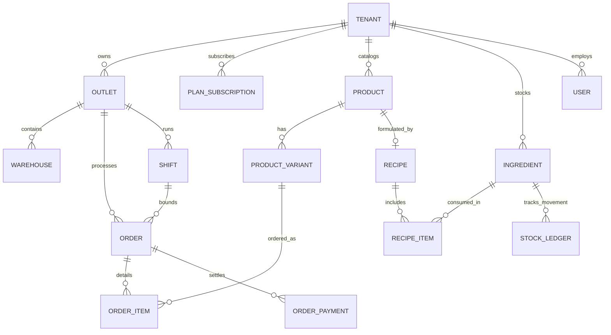
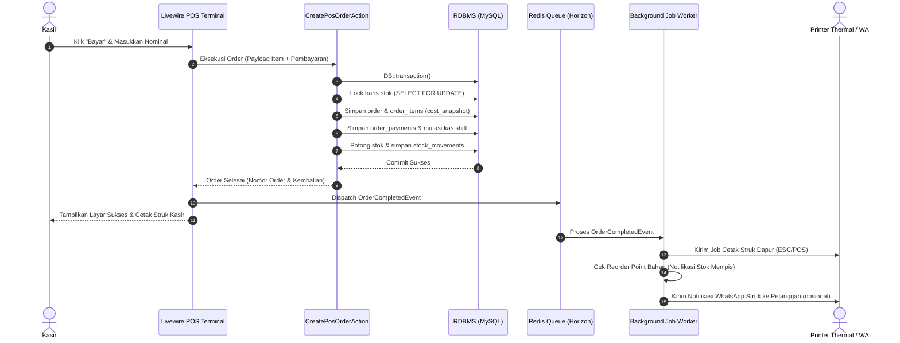

# Arsitektur Sistem POS Lokara (Multi-Tenant SaaS)

Dokumen ini mendefinisikan arsitektur sistem, infrastruktur, strategi multi-tenancy, hierarki data, dan standar teknis aplikasi **POS Lokara** berbasis **Laravel 11/12 + Filament 3**.

---

## 1. Ringkasan Arsitektur & Teknologi

Sistem POS Lokara dirancang menggunakan pola **Modular Monolith** dengan pemisahan panel Filament yang tegas antara **Super Admin Platform** dan **Tenant Back Office**, serta sebuah **Custom Livewire Full-Screen SPA** untuk terminal kasir (POS).

```
┌─────────────────────────────────────────────────────────────────────────────┐
│                            DNS / Cloudflare Edge                            │
│           (Wildcard SSL *.lokara.id + Custom Domains CNAME)                 │
└──────────────────────────────────────┬──────────────────────────────────────┘
                                       │
                                       ▼
┌─────────────────────────────────────────────────────────────────────────────┐
│                           Nginx Reverse Proxy                               │
└──────┬───────────────────────────────┬───────────────────────────────┬──────┘
       │ admin.lokara.id               │ {tenant}.lokara.id            │ lokara.id
       ▼                               ▼                               ▼
┌──────────────────────────────┐┌──────────────────────────────┐┌──────────────┐
│     Panel Super Admin        ││  Panel Tenant (Back Office)  ││ Landing Page │
│   (Filament Panel: admin)    ││    (Filament Panel: app)     ││  & Checkout  │
│  Guard: platform (SuperUser) ││    Guard: web (TenantUser)   ││ (Blade+Tail) │
└──────────────────────────────┘└──────────────┬───────────────┘└──────────────┘
                                               │
                                               ▼
                                ┌──────────────────────────────┐
                                │   Layar Kasir (POS Screen)   │
                                │   (/pos - Livewire Custom)   │
                                └──────────────────────────────┘
                                               │
       ┌───────────────────────────────────────┴──────────────────────────────┐
       │                                                                      │
       ▼                                                                      ▼
┌──────────────────────────────┐                       ┌──────────────────────┐
│ MySQL 8 / PostgreSQL         │                       │ Redis 7              │
│ - Single DB + tenant_id      │                       │ - Cache & Session    │
│ - Global Scopes & Foreign Key│                       │ - Queue Horizon      │
│ - Strict DB Transactions     │                       │ - Lock Engine (POS)  │
└──────────────────────────────┘                       └──────────────────────┘
```

### 1.1 Tech Stack Lengkap

| Layer | Komponen / Library | Fungsi & Peran |
|---|---|---|
| **Core Framework** | Laravel 11/12 (PHP 8.3+) | Foundation, routing, Eloquent ORM, service container |
| **Admin & Backoffice** | Filament v3 / v4 | Dashboard Super Admin & Tenant Backoffice Resource |
| **UI Reactive** | Livewire 3 + Alpine.js | Real-time state reactivity di panel dan POS |
| **Styling** | Tailwind CSS v3/v4 | Custom styling, layout responsif POS dan landing page |
| **Multi-Tenancy** | Single DB (`tenant_id`) + `stancl/tenancy` (opsional driver) | Isolasi data aman via trait `BelongsToTenant` & subdomain resolver |
| **Auth & Permissions** | `bezhansalleh/filament-shield` + `spatie/laravel-permission` | Granular RBAC per tenant (Owner, Manager, Cashier, Warehouse) |
| **Database** | MySQL 8.0+ atau PostgreSQL 16+ | RDBMS transaksi ACID, indexing, JSON data types |
| **Queue & Cache** | Redis 7 + Laravel Horizon | Background jobs (HPP recalculation, email, WA, PDF, queue lock) |
| **Penyimpanan Media** | `spatie/laravel-medialibrary` -> S3 / R2 / MinIO | Foto produk, avatar, logo outlet, nota/invoice tenant |
| **Cetak Struk Thermal** | `mike42/escpos-php`, RawBT (Android), WebUSB | Direct print ESC/POS network & USB thermal printer (58mm/80mm) |
| **Payment Gateway** | Midtrans / Xendit / Duitku SDK | QRIS Dinamis, Virtual Account, E-Wallet (Subscription & POS) |
| **WhatsApp Gateway** | Fonnte / Wablas / WA Cloud API | Struk digital otomatis, OTP verifikasi, pengingat tagihan |
| **Barcode & QR** | `milon/barcode`, `endroid/qr-code` | Label SKU bahan/produk, barcode scan kasir, QRIS display |
| **Reporting & Export** | `maatwebsite/excel`, `spatie/laravel-pdf` (Chromium) | Ekspor XLSX/CSV, Cetak Laporan Keuangan, PO PDF |
| **Audit & Monitoring** | `spatie/laravel-activitylog`, Sentry, Laravel Pulse | Jejak audit void kasir, stok opname, metrik server |

---

## 2. Strategi Multi-Tenancy

### 2.1 Pola Isolasi Data: Single Database dengan Scoped Tenant
Untuk tahap awal (MVP hingga ribuan tenant), Lokara mengadopsi model **Single Database with Scoped Tenancy**:
1. Setiap tabel yang berhubungan dengan data tenant memiliki kolom indeks:
   ```sql
   `tenant_id` BIGINT UNSIGNED NOT NULL,
   FOREIGN KEY (`tenant_id`) REFERENCES `tenants`(`id`) ON DELETE CASCADE
   ```
2. Isolasi otomatis diterapkan melalui model concern/trait `BelongsToTenant`:
   ```php
   namespace App\Models\Concerns;

   use App\Models\Tenant;
   use Illuminate\Database\Eloquent\Builder;
   use Illuminate\Database\Eloquent\Relations\BelongsTo;

   trait BelongsToTenant
   {
       protected static function bootBelongsToTenant(): void
       {
           static::creating(function ($model) {
               if (! $model->tenant_id && auth()->check() && Filament::getTenant()) {
                   $model->tenant_id = Filament::getTenant()->id;
               }
           });

           static::addGlobalScope('tenant', function (Builder $builder) {
               if ($tenant = Filament::getTenant()) {
                   $builder->where($builder->getModel()->getTable() . '.tenant_id', $tenant->id);
               }
           });
       }

       public function tenant(): BelongsTo
       {
           return $this->belongsTo(Tenant::class);
       }
   }
   ```
3. **Pemisahan Domain & Subdomain**:
   - Platform Super Admin: `admin.lokara.id` (Auth Guard: `platform`)
   - Tenant Panel & POS: `{subdomain}.lokara.id` (Auth Guard: `web` berscoping tenant)
   - Dukungan Custom Domain: Tenant paket Business/Enterprise dapat menggunakan CNAME seperti `pos.kopisenja.com`.

---

## 3. Struktur Multi-Panel Filament

Filament v3 menyediakan arsitektur multi-panel bawaan yang sangat efisien:

```
app/Providers/Filament/
├── AdminPanelProvider.php   // Panel Super Admin (admin.lokara.id)
└── AppPanelProvider.php     // Panel Tenant ({tenant}.lokara.id/app)
```

### 3.1 Konfigurasi Panel Super Admin (`admin`)
```php
public function panel(Panel $panel): Panel
{
    return $panel
        ->default()
        ->id('admin')
        ->path('')
        ->domain(config('app.admin_domain', 'admin.lokara.id'))
        ->authGuard('platform')
        ->login()
        ->colors([
            'primary' => Color::Amber,
        ])
        ->discoverResources(in: app_path('Filament/Admin/Resources'), for: 'App\\Filament\\Admin\\Resources')
        ->discoverPages(in: app_path('Filament/Admin/Pages'), for: 'App\\Filament\\Admin\\Pages')
        ->discoverWidgets(in: app_path('Filament/Admin/Widgets'), for: 'App\\Filament\\Admin\\Widgets');
}
```

### 3.2 Konfigurasi Panel Tenant (`app`)
```php
public function panel(Panel $panel): Panel
{
    return $panel
        ->id('app')
        ->path('app')
        ->domain('{tenant}.' . config('app.domain', 'lokara.id'))
        ->tenant(Tenant::class, slugAttribute: 'slug')
        ->tenantMiddleware([
            \App\Http\Middleware\EnsureTenantSubscriptionActive::class,
        ], isPersistent: true)
        ->authGuard('web')
        ->login()
        ->colors([
            'primary' => Color::Emerald,
        ])
        ->discoverResources(in: app_path('Filament/App/Resources'), for: 'App\\Filament\\App\\Resources')
        ->discoverPages(in: app_path('Filament/App/Pages'), for: 'App\\Filament\\App\\Pages')
        ->discoverWidgets(in: app_path('Filament/App/Widgets'), for: 'App\\Filament\\App\\Widgets');
}
```

### 3.3 Layar Kasir POS (Custom Livewire Page)
Halaman kasir tidak menggunakan form Filament standar, melainkan sebuah **Full-Screen Livewire Component** di route:
`https://{tenant}.lokara.id/pos`
- Layout khusus kasir (`resources/views/layouts/pos.blade.php`) tanpa sidebar admin.
- Didesain untuk layar sentuh tablet/desktop 10" - 24" dengan respon latensi < 100ms.
- Shortcut keyboard (`F1` - `F12`, `ESC`, `Enter`, `Space`) untuk operasi tanpa mouse.

---

## 4. Struktur Database & Entitas Global

Berikut adalah relasi entitas inti sistem POS Lokara:



### 4.1 Prinsip Desain Data Kritis
1. **Cost Snapshotting**:
   Kolom `cost_snapshot` (HPP pada saat transaksi) wajib disimpan di tabel `order_items`. Dengan cara ini, fluktuasi harga bahan baku di masa depan tidak akan merusak kalkulasi laba rugi transaksi historis.
2. **Immutable Stock Ledger**:
   Semua pergerakan persediaan (penjualan, transfer, opname, penerimaan barang, waste) dicatat ke dalam tabel append-only `stock_movements`. Nilai stok fisik pada tabel `stocks` dihitung atau diperbarui via database transaction atomic.
3. **Pessimistic Concurrency Control**:
   Saat transaksi POS disimpan, pemotongan stok bahan menggunakan `SELECT ... FOR UPDATE` untuk mencegah race condition pada multi-kasir.

---

## 5. Arsitektur Kode: Actions & Services Pattern

Untuk menjaga controllers dan Filament Resources tetap ramping (*thin controller*), seluruh logika bisnis dienkapsulasi dalam **Action Class** (Single Responsibility) dan **Domain Services**:

```
app/
├── Actions/
│   ├── Orders/
│   │   ├── CreatePosOrderAction.php
│   │   ├── VoidOrderAction.php
│   │   └── RefundOrderAction.php
│   ├── Stock/
│   │   ├── DeductStockFromRecipeAction.php
│   │   ├── RecordStockMovementAction.php
│   │   └── TransferStockAction.php
│   ├── Costing/
│   │   ├── CalculateRecipeHppAction.php
│   │   └── RecalculateWeightedAverageCostAction.php
│   └── Subscriptions/
│       ├── ProvisionTenantAction.php
│       └── HandlePaymentWebhookAction.php
├── Services/
│   ├── Costing/CostingEngine.php
│   ├── Printing/EscPosPrintService.php
│   ├── Notification/WhatsAppService.php
│   └── Billing/PaymentGatewayService.php
```

---

## 6. Alur Transaksi & Pemrosesan Latar Belakang (Event-Driven)



---

## 7. Strategi Kinerja & Skalabilitas

1. **Caching Layer**:
   - Menu katalog POS di-cache per outlet menggunakan Redis Tag: `tenant_{id}_outlet_{id}_catalog`.
   - Invalidation dilakukan hanya ketika ada perubahan harga, ketersediaan, atau produk baru via Eloquent Observer.
2. **Database Indexing**:
   - Composite Index wajib: `(tenant_id, outlet_id, created_at)` pada tabel `orders` dan `stock_movements`.
   - Index pencarian: `(tenant_id, sku)`, `(tenant_id, barcode)`.
3. **Queue Prioritization**:
   - Queue `high`: Notifikasi webhook pembayaran dan pemotongan stok kritis.
   - Queue `default`: Cetak struk thermal dan dispatch pesan WhatsApp.
   - Queue `low`: Hitung ulang agregasi laporan harian dan ekspor Excel besar.

---

## 8. Keamanan & Kepatuhan Data

- **Tenant Isolation Testing**: Setiap unit & feature test (Pest) menguji assertion bahwa data tenant A tidak pernah bocor ke query tenant B.
- **PIN Authorization**: Operasi kasir berisiko tinggi (Void order, Manual Discount di atas batas, No-sale cash drawer open) memerlukan modal popup PIN otorisasi Manajer.
- **Audit Trails**: Integrasi `spatie/laravel-activitylog` mencatat setiap perubahan data master bahan, HPP, resep, dan perubahan role.
- **Data Retention & Soft Deletes**: Seluruh data transaksi penjualan menggunakan `SoftDeletes` dan dilarang dihapus secara permanen guna keperluan audit fiskal.

