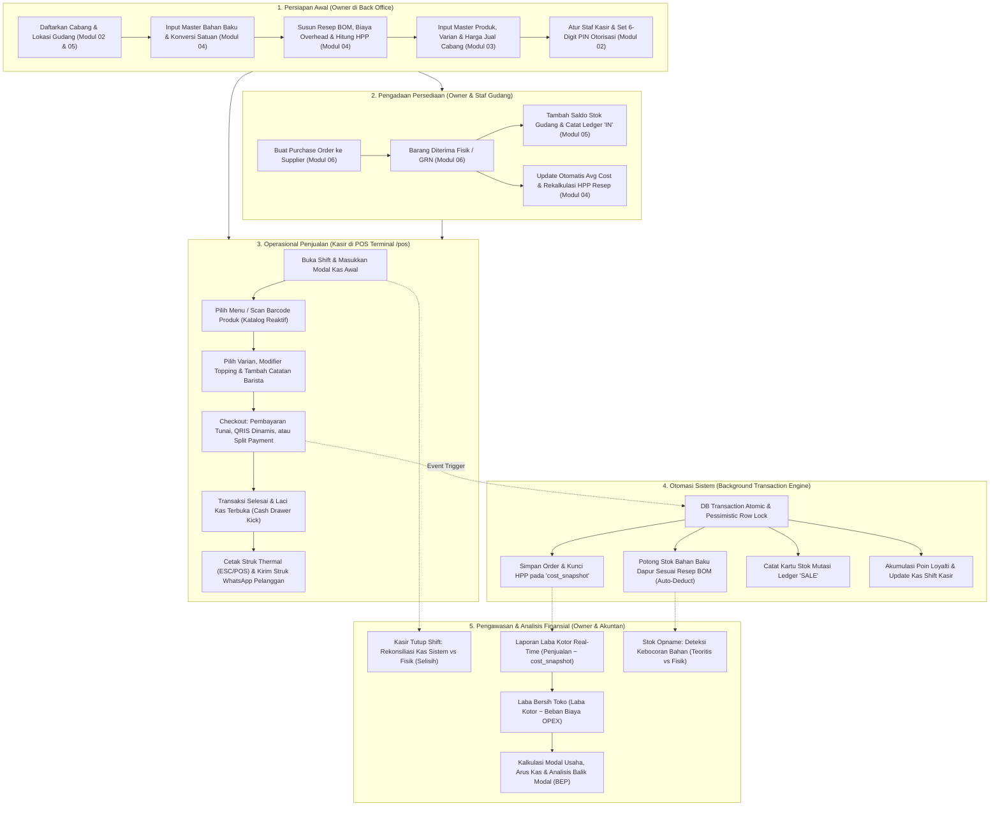

# Arsitektur & Alur Fitur Tenant (Back Office & POS Kasir)

Dokumen ini memetakan seluruh **arsitektur alur fitur (*feature flow architecture*)**, hierarki menu, pembagian hak akses (*role-based access control*), serta siklus data (*data lifecycle*) untuk **Level Tenant** (Back Office) dan **Terminal Kasir (POS)** pada platform POS Lokara.

---

## 1. Pemetaan Modul Sistem ke Domain Tenant

Dari 10 modul sistem POS Lokara, berikut adalah modul-modul yang berada di dalam domain Tenant:

```
┌─────────────────────────────────────────────────────────────────────────────┐
│                          DOMAIN PLATFORM (SAAS)                             │
│       Modul 01: Super Admin & Billing   │   Modul 10: Landing & Onboarding  │
└──────────────────────────────────────┬──────────────────────────────────────┘
                                       │ Mendaftarkan & Mengaktifkan Tenant
                                       ▼
┌─────────────────────────────────────────────────────────────────────────────┐
│                          DOMAIN TENANT (BISNIS)                             │
├──────────────────────────────────────┬──────────────────────────────────────┤
│  🏢 BACK OFFICE (Admin / Owner)      │  🖥️ POS TERMINAL (Front-Office Kasir)│
│                                      │                                      │
│  • Modul 02: Outlet & Karyawan       │  • Modul 07: Layar Kasir Sentuh      │
│  • Modul 03: Master Produk & Varian  │  • Buka / Tutup Shift & Kas          │
│  • Modul 04: Bahan, Resep & HPP      │  • Keranjang, Varian & Modifier      │
│  • Modul 05: Multi-Gudang & Stok     │  • Pembayaran Tunai / QRIS / Split   │
│  • Modul 06: Pembelian & Supplier    │  • Cetak Struk ESC/POS & WhatsApp    │
│  • Modul 08: Transaksi, CRM & Promo  │  • Otorisasi PIN Void / Diskon       │
│  • Modul 09: Keuangan & Laba Rugi    │                                      │
└──────────────────────────────────────┴──────────────────────────────────────┘
```

---

## 2. Matriks Menu & Hak Akses per Peran (Role RBAC)

| Menu / Fitur | Role: Owner | Role: Manager | Role: Kasir (POS) | Role: Gudang | Role: Akuntan |
|---|:---:|:---:|:---:|:---:|:---:|
| **Terminal Kasir POS (`/pos`)** | ✅ | ✅ | ✅ *(Utama)* | ❌ | ❌ |
| **Shift & Kas Kecil (Buka/Tutup)**| ✅ | ✅ | ✅ | ❌ | ❌ |
| **Dashboard Back Office** | ✅ | ✅ *(Outletnya)*| ❌ | ❌ | ✅ *(Finansial)* |
| **Cabang & Profil Toko** | ✅ | 👁️ *(Lihat saja)*| ❌ | ❌ | ❌ |
| **Karyawan, Role & PIN Kasir** | ✅ | 👁️ *(Lihat saja)*| ❌ | ❌ | ❌ |
| **Master Produk & Harga** | ✅ | ✅ | ❌ | 👁️ *(Lihat stok)*| ❌ |
| **Bahan Baku, Resep BOM & HPP**| ✅ | ✅ | ❌ | 👁️ *(Lihat bahan)*| 👁️ *(Audit HPP)* |
| **Stok Saldo & Mutasi Ledger** | ✅ | ✅ | ❌ | ✅ *(Utama)* | 👁️ *(Valuasi)* |
| **Transfer Antar Gudang** | ✅ *(Approve)* | ✅ *(Approve)* | ❌ | ✅ *(Kirim/Terima)*| ❌ |
| **Stok Opname Fisik** | ✅ *(Approve)* | ✅ *(Approve)* | ❌ | ✅ *(Input fisik)* | 👁️ *(Audit selisih)*|
| **Pembelian (PO) & Supplier** | ✅ *(Approve)* | ✅ *(Draft)* | ❌ | ✅ *(Terima GRN)* | ✅ *(Hutang)* |
| **Riwayat Transaksi & Order** | ✅ | ✅ | 👁️ *(Shift sendiri)*| ❌ | ✅ |
| **Otorisasi Void / Refund** | ✅ | ✅ *(Gunakan PIN)*| ❌ *(Perlu izin)* | ❌ | ❌ |
| **CRM, Loyalti & Promosi** | ✅ | ✅ | ❌ | ❌ | ❌ |
| **Biaya Operasional (OPEX)** | ✅ | ✅ *(Input kas)* | ❌ | ❌ | ✅ *(Utama)* |
| **Laba Rugi & Analisis BEP** | ✅ | ❌ | ❌ | ❌ | ✅ *(Utama)* |
| **Laporan Varians Bahan (Bocor)**| ✅ | ✅ | ❌ | ✅ | ✅ |

---

## 3. Diagram Alur Arsitektur End-to-End (Owner & POS Kasir)

Berikut adalah interaksi visual antara pengaturan yang dilakukan Owner di Back Office dengan operasional harian Kasir di Terminal POS:



---

## 4. Alur Kerja Spesifik per Domain Fitur

### 4.1 Alur Pengelolaan Bahan Baku, Resep & Engine HPP (Modul 04)
1. **Input Bahan Baku**:
   - Owner mendaftarkan bahan: *Biji Kopi Arabika House Blend*.
   - Satuan Beli: *Kilogram (Rp 180.000 / kg)*.
   - Satuan Pakai: *Gram (Faktor konversi = 1.000)*.
   - Harga pokok per gram: $\text{Rp } 180.000 \div 1.000 = \text{Rp } 180/\text{gram}$.
2. **Penyusunan Resep (BOM)**:
   - Owner membuat resep menu: *Es Kopi Susu Aren (Cup 16oz)*:
     - Espresso: 18 gram biji kopi ($\text{Rp } 3.240$).
     - Susu UHT: 120 ml ($\text{Rp } 2.160$).
     - Gula Aren Cair (Sub-Resep): 25 ml ($\text{Rp } 750$).
     - Cup, Tutup & Sedotan: 1 set kemasan ($\text{Rp } 1.100$).
     - Biaya Overhead (Listrik/Es batu): ($\text{Rp } 500$).
   - **Total HPP per Cup**: $\text{Rp } 7.750$.
3. **Penetapan Harga & Margin**:
   - Jika harga jual diset $\text{Rp } 22.000$:
     - Gross Margin: $\text{Rp } 22.000 - \text{Rp } 7.750 = \text{Rp } 14.250$ ($64,7\%$).
     - Food Cost %: $\text{Rp } 7.750 \div \text{Rp } 22.000 \times 100\% = 35,2\%$.
4. **Trigger Update Harga Otomatis**:
   - Saat ada penerimaan barang (GRN) dari supplier dengan harga biji kopi baru ($\text{Rp } 200.000/\text{kg}$):
     - Sistem memperbarui rata-rata bergerak (*Weighted Moving Average*).
     - Job antrean latar belakang menghitung ulang HPP menu secara otomatis.

---

### 4.2 Alur Transaksi Kasir & Pemotongan Stok Atomik (Modul 05 & 07)
Saat pelanggan memesan di kasir:

```
[Kasir Klik Menu 'Es Kopi Susu Aren' + Topping Boba]
                       │
                       ▼
[Pilih Metode Bayar: QRIS Dinamis / Tunai] ──> [Pembayaran Berhasil]
                       │
                       ├────────────────────────────────────────────────────────┐
                       ▼                                                        ▼
         [Pencatatan Finansial]                                   [Pengurangan Persediaan Fisik]
• Simpan Order ID & Nomor Struk                          • Potong 18g Biji Kopi di Gudang Dapur
• Simpan 'cost_snapshot' = Rp 8.950                      • Potong 120ml Susu UHT di Gudang Dapur
• Simpan Order Payment & Kas Shift                       • Potong 40g Boba Matang (Modifier)
• Cetak Struk ESC/POS & Kirim WA                         • Catat Kartu Stok Mutasi 'SALE'
```

- **Pessimistic Locking**: Baris stok bahan baku dikunci sementara (`lockForUpdate`) dalam waktu milidetik saat transaksi di-commit agar mencegah stok minus ketika beberapa kasir memproses pesanan secara bersamaan.
- **Cost Snapshot Guarantee**: Nilai HPP $\text{Rp } 8.950$ dikunci permanen pada transaksi ini. Laporan laba bulan ini tidak akan berubah meskipun harga susu naik bulan depan.

---

### 4.3 Alur Otorisasi Supervisor (PIN Verification)
Operasi kasir yang berisiko kecurangan dilindungi oleh modal otorisasi:
1. **Pemicu Aksi**:
   - Kasir menekan tombol **Void Struk**, **Refund Dana**, atau **Diskon Khusus di atas 10%**.
2. **Popup Modal PIN**:
   - Layar meminta 6-digit PIN Supervisor / Owner.
3. **Validasi**:
   - Sistem memverifikasi hash PIN terhadap user dengan role `owner` atau `tenant_manager`.
4. **Pencatatan Audit**:
   - Setiap void/refund wajib menyertakan alasan teks (misal: *Salah input varian oleh pelanggan*).
   - Data tercatat ke tabel `void_audits` dan kartu stok melakukan pembalikan (*Restock Ledger*).

---

### 4.4 Alur Deteksi Kebocoran Bahan (Teoritis vs Aktual di Modul 09)
Instrumen kontrol owner terhadap integritas staf dapur:

$$\begin{aligned}
\text{Pemakaian Teoritis} &= \text{Penjualan Menu} \times \text{Formula Resep} \\
\text{Pemakaian Aktual} &= \text{Stok Awal} + \text{Pembelian GRN} - \text{Stok Akhir Opname} \\
\text{Selisih Varians} &= \text{Pemakaian Aktual} - \text{Pemakaian Teoritis}
\end{aligned}$$

- **Analisis Sistem**:
  - Jika selisih mendekati $0\%$: Porsi barista presisi sesuai SOP.
  - Jika selisih positif tinggi ($>8\%$): Terjadi kebocoran (tumpah/rusak tidak dicatat, porsi berlebih, atau bahan baku dicuri).

---

## 5. Struktur URL & Sitemap Tenant

### 5.1 Back Office Tenant (`{tenant}.lokara.id/app`)
```
├── 📊 /app                                  (Dashboard Tenant & Alert Stok)
├── 🏢 /app/outlets                          (Daftar Outlet & Cabang)
├── 👥 /app/users                            (Karyawan, Role Shield & PIN)
├── ☕ /app/products                         (Master Produk & Varian)
├── 📂 /app/categories                       (Kategori Menu)
├── ➕ /app/modifier-groups                  (Topping & Modifier Add-on)
├── 🧪 /app/ingredients                      (Master Bahan Baku Gram/ml)
├── 📖 /app/recipes                          (Resep BOM & Kalkulasi HPP)
├── 🏬 /app/stocks                           (Saldo Persediaan & Lokasi Gudang)
├── 📜 /app/stock-movements                  (Kartu Stok Mutasi Ledger)
├── 🚚 /app/stock-transfers                  (Transfer Antar Gudang & Approval)
├── 📋 /app/stock-opnames                    (Stok Opname Fisik & Selisih)
├── 🛒 /app/purchase-orders                  (Purchase Order ke Supplier)
├── 📦 /app/goods-receipts                   (Penerimaan Barang Fisik GRN)
├── 🧾 /app/orders                           (Riwayat Transaksi & Snapshot HPP)
├── 👥 /app/customers                        (Data Pelanggan CRM & Poin)
├── 🏷️ /app/promotions                       (Diskon, Kupon & Happy Hour)
├── 💵 /app/shifts                           (Riwayat Shift Kasir & Selisih Kas)
├── 💸 /app/expenses                         (Pencatatan Beban OPEX)
├── 📈 /app/reports/profit-loss              (Laporan Laba Rugi Real-Time)
├── 🔍 /app/reports/ingredient-variance      (Laporan Varians Kebocoran Bahan)
└── ⚙️ /app/settings                         (Pengaturan Struk, Pajak & Printer)
```

### 5.2 Layar Terminal Kasir Sentuh (`{tenant}.lokara.id/pos`)
```
├── 🖥️ /pos                                  (Full-Screen Livewire Cashier SPA)
│   ├── Buka Shift (Modal Kas Awal)
│   ├── Grid Katalog & Scan Barcode
│   ├── Keranjang Belanja & Catatan Pesanan
│   ├── Modal Varian & Modifier Topping
│   ├── Modal Pembayaran (Tunai Kembalian / QRIS / Split)
│   ├── Modal Struk Sukses & Kirim WhatsApp
│   └── Tutup Shift (Blind Drop Rekonsiliasi Kas)
```

