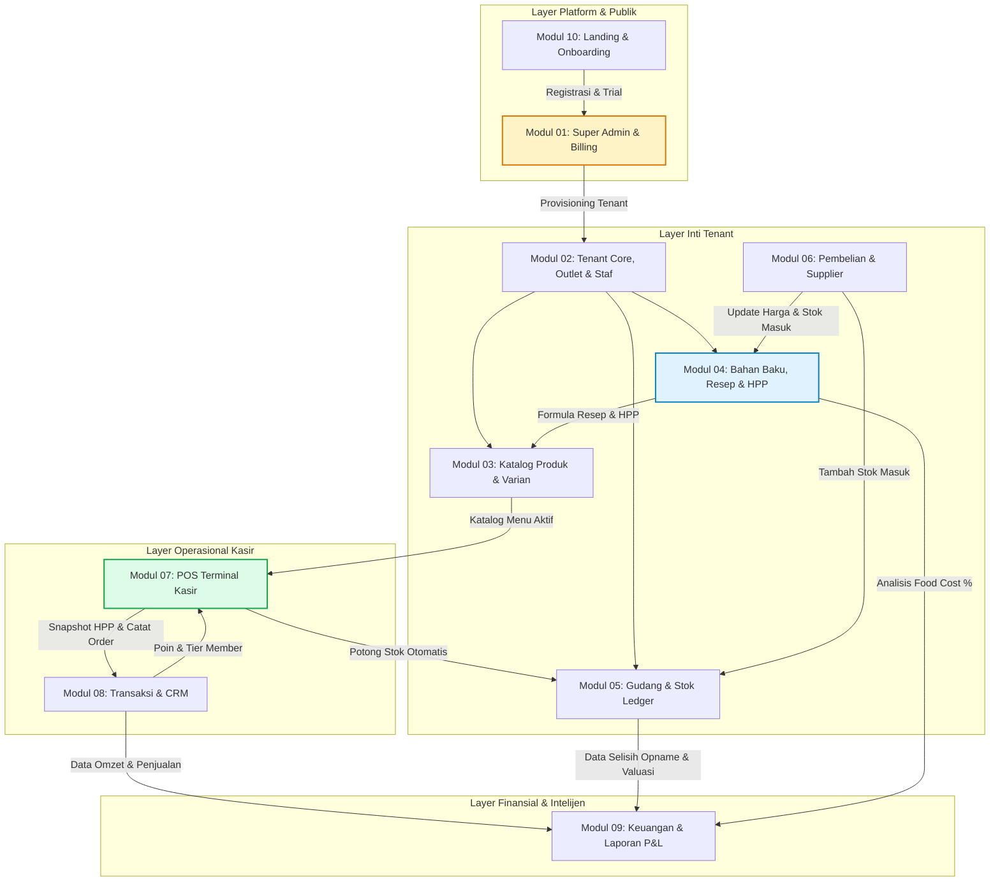

# Dokumentasi Arsitektur & Spesifikasi Modul POS Lokara (Multi-Tenant SaaS)

Selamat datang di repositori dokumentasi arsitektur dan spesifikasi modular **POS Lokara**. Dokumen ini merinci dekomposisi sistem dari cetak biru (*blueprint*) aplikasi POS Multi-Tenant berbasis **Laravel 11/12 + Filament 3 + Livewire 3**, yang dirancang khusus untuk memadukan kecepatan kasir, presisi persediaan bahan baku, dan perhitungan Harga Pokok Penjualan (HPP / BOM) otomatis.

---

## 1. Peta Navigasi Dokumentasi

Dokumentasi ini dibagi menjadi dokumen arsitektur global dan 10 dokumen spesifikasi modul terpisah:

```
docs/
├── 📄 README.md                          ← [Dokumen Ini] Penjelasan Master & Ringkasan Modul
├── 📄 01-arsitektur-sistem.md            ← Arsitektur Sistem, Multi-Tenancy, Database & Deployment
├── 📄 02-arsitektur-flow-tenant-pos.md    ← Arsitektur & Alur Fitur Tenant (Owner & POS Kasir)
├── 📄 blueprint-pos-multitenant.md       ← Berkas Blueprint Asal
└── 📁 modules/
    ├── 📄 01-platform-superadmin.md      ← Modul 01: Platform & SaaS Super Admin
    ├── 📄 02-tenant-dan-outlet.md        ← Modul 02: Tenant Core, Multi-Outlet & Manajemen Karyawan
    ├── 📄 03-katalog-produk.md           ← Modul 03: Master Produk, Kategori, Varian & Modifier
    ├── 📄 04-bahan-resep-hpp.md          ← Modul 04: Master Bahan Baku, Resep (BOM) & Engine HPP (Inti)
    ├── 📄 05-inventori-stok-gudang.md    ← Modul 05: Manajemen Multi-Gudang, Stok Ledger & Opname
    ├── 📄 06-pembelian-supplier.md       ← Modul 06: Pembelian (Procurement), Supplier & Hutang
    ├── 📄 07-pos-terminal-kasir.md       ← Modul 07: POS Terminal Kasir (Layar Penjualan & Pembayaran)
    ├── 📄 08-penjualan-crm-promosi.md    ← Modul 08: Transaksi Penjualan, Pelanggan (CRM) & Promosi
    ├── 📄 09-keuangan-laporan-analitik.md← Modul 09: Keuangan Operasional, Laba Rugi & Analitik
    └── 📄 10-landing-onboarding.md       ← Modul 10: Landing Page Publik & Self-Onboarding Tenant
```

---

## 2. Ringkasan Eksekutif Produk (POS Lokara)

| Parameter | Spesifikasi |
|---|---|
| **Nama Produk** | POS Lokara (Lokara Point of Sale & Inventory Engine) |
| **Model Bisnis** | Software-as-a-Service (SaaS) Multi-Tenant berbasis langganan bulanan/tahunan |
| **Target Vertikal** | F&B (Kafe, Coffee Shop, Restoran, Bakery), Retail Minimarket, Laundry, Barbershop/Salon, Grosir |
| **Nilai Jual Utama (USP)** | **Kalkulasi HPP Otomatis hingga level gram/ml**, pemotongan stok bahan baku otomatis (*auto-deduct*) saat kasir menjual, deteksi selisih kebocoran bahan (teoritis vs aktual), dan laporan laba rugi real-time |
| **Platform Target** | Web Responsif / PWA (Kompatibel dengan Tablet Android/iPad, Layar Sentuh POS Windows/Mac, dan Smartphone) |

---

## 3. Matriks Teknologi (Tech Stack)

Sistem dibangun secara ketat mengikuti tumpukan teknologi modern ekosistem Laravel:

```
┌────────────────────────────────────────────────────────────────────────┐
│                        TUMPUKAN TEKNOLOGI INTI                         │
├───────────────────┬────────────────────────────────────────────────────┤
│ Framework Inti    │ Laravel 11/12 (PHP 8.3+)                           │
│ Admin & Backoffice│ Filament v3 (Panel Super Admin & Panel Tenant)     │
│ UI Reaktif POS    │ Livewire 3 + Alpine.js + Tailwind CSS              │
│ Layar Kasir       │ Custom Full-Screen SPA Component (/pos)            │
│ Basis Data        │ MySQL 8.0+ / PostgreSQL 16+ (Scoped tenant_id)     │
│ Antrean & Cache   │ Redis 7 + Laravel Horizon                          │
│ Role & Izin       │ bezhansalleh/filament-shield + spatie/permission   │
│ Cetak Struk POS   │ mike42/escpos-php + WebUSB + RawBT Android         │
│ Payment Gateway   │ Midtrans / Xendit / Duitku (QRIS Dinamis, VA, EW)  │
│ Notifikasi WhatsApp│ Fonnte / Wablas / Meta WhatsApp Cloud API          │
│ Cetak Dokumen/PDF │ spatie/laravel-pdf (Chromium headless)             │
│ Audit & Logging   │ spatie/laravel-activitylog                         │
└───────────────────┴────────────────────────────────────────────────────┘
```

---

## 4. Ikhtisar & Dekomposisi 10 Modul

Berikut adalah pemetaan fungsi dan relasi antar modul dalam ekosistem POS Lokara:



### Rincian 10 Modul:

1. **[Modul 01: Platform & SaaS Super Admin](file:///Users/calvin/Coding%20Projek/lokara/docs/modules/01-platform-superadmin.md)**
   - *Fungsi*: Pengelolaan seluruh tenant SaaS, paket langganan, billing otomatis, webhook pembayaran Midtrans, preset template bisnis, dan fitur impersonasi support.
   - *Menu Utama*: Dashboard Platform, Daftar Tenant, Paket Langganan, Invoicing, Template Usaha, System Health.
2. **[Modul 02: Tenant Core, Multi-Outlet & Manajemen Karyawan](file:///Users/calvin/Coding%20Projek/lokara/docs/modules/02-tenant-dan-outlet.md)**
   - *Fungsi*: Pengaturan profil bisnis cabang/outlet, pajak dan service charge per outlet, pengaturan struk, granular RBAC (Filament Shield), verifikasi PIN kasir 6 digit, serta manajemen buka-tutup shift dan kas kecil (*petty cash*).
   - *Menu Utama*: Profil Usaha, Cabang/Outlet, Karyawan & Staf, Peran & Hak Akses, Sesi Shift, Arus Kas Masuk/Keluar.
3. **[Modul 03: Master Produk, Kategori, Varian & Modifier](file:///Users/calvin/Coding%20Projek/lokara/docs/modules/03-katalog-produk.md)**
   - *Fungsi*: Katalog produk 4 tipe (Barang jadi, Produk Berresep, Jasa, Bundling), varian ukuran/warna, grup modifier & topping, SKU & barcode generator, multi-harga cabang, dan impor-ekspor massal Excel.
   - *Menu Utama*: Semua Produk, Kategori, Grup Modifier, Satuan Jual, Harga Cabang, Impor/Ekspor.
4. **[Modul 04: Master Bahan Baku, Resep (BOM) & Engine HPP](file:///Users/calvin/Coding%20Projek/lokara/docs/modules/04-bahan-resep-hpp.md)** *(Keunggulan Utama)*
   - *Fungsi*: Master bahan baku hingga gram/ml, konversi satuan beli-ke-pakai, metode costing (Weighted Moving Average, Last Cost, FIFO), sub-resep bertingkat, faktor susut/waste %, biaya overhead/kemasan, simulator kenaikan harga bahan, dan analisis target Food Cost %.
   - *Menu Utama*: Master Bahan Baku, Sub-Resep, Resep Produk (BOM), Simulator HPP, Analisis Food Cost %.
5. **[Modul 05: Manajemen Multi-Gudang, Stok Ledger & Opname](file:///Users/calvin/Coding%20Projek/lokara/docs/modules/05-inventori-stok-gudang.md)**
   - *Fungsi*: Multi-gudang (pusat, dapur, rak display), kartu stok (*immutable ledger*), pemotongan stok otomatis (*auto-deduct*) saat kasir menjual, mutasi transfer antar cabang dengan approval, stok opname blind count, serta pelacakan FEFO batch expired.
   - *Menu Utama*: Saldo Stok, Kartu Stok Mutasi, Lokasi Gudang, Transfer Cabang, Stok Opname Fisik, Batch & Expired.
6. **[Modul 06: Pembelian (Procurement), Supplier & Hutang](file:///Users/calvin/Coding%20Projek/lokara/docs/modules/06-pembelian-supplier.md)**
   - *Fungsi*: Master vendor, Purchase Order (PO) PDF, Goods Receipt (GRN), retur supplier, auto-update harga beli yang memicu kalkulasi ulang HPP resep, jadwal tempo hutang supplier, serta rekomendasi belanja otomatis.
   - *Menu Utama*: Purchase Order, Penerimaan Barang (GRN), Retur Pembelian, Vendor/Supplier, Hutang Supplier.
7. **[Modul 07: POS Terminal Kasir (Layar Penjualan & Pembayaran)](file:///Users/calvin/Coding%20Projek/lokara/docs/modules/07-pos-terminal-kasir.md)** *(Layar Front-Office)*
   - *Fungsi*: Layar kasir sentuh full-screen (Livewire 3 SPA), keranjang belanja, catatan pesanan barista, pemilih modifier, order type (Dine-in / Take-away / Delivery), Hold/Recall order, pembayaran tunai kembalian cepat, QRIS dinamis, cetak struk thermal ESC/POS, kirim struk via WhatsApp, dan otorisasi PIN supervisor.
   - *Route Khusus*: `https://{tenant}.lokara.id/pos`.
8. **[Modul 08: Transaksi Penjualan, Pelanggan (CRM) & Promosi](file:///Users/calvin/Coding%20Projek/lokara/docs/modules/08-penjualan-crm-promosi.md)**
   - *Fungsi*: Riwayat transaksi back-office lengkap dengan snapshot HPP, alur void & refund, profil CRM pelanggan (RFM analytics), grup member tier, akumulasi poin loyalti, piutang tempo pelanggan grosir, dan promo engine (BOGO, Happy Hour, Kupon).
   - *Menu Utama*: Riwayat Transaksi, Void & Refund, Data Pelanggan, Tier Member, Poin Loyalti, Diskon & Promo.
9. **[Modul 09: Keuangan Operasional, Laba Rugi & Laporan Analitik](file:///Users/calvin/Coding%20Projek/lokara/docs/modules/09-keuangan-laporan-analitik.md)**
   - *Fungsi*: Pencatatan beban pengeluaran (OPEX), arus kas harian, laporan laba rugi real-time (Penjualan − HPP Snapshot − Biaya Operasional), kalkulator BEP & modal awal, laporan varians pemakaian bahan (Teoritis vs Aktual untuk deteksi kebocoran dapur), dan ekspor akuntansi (Jurnal.id/Accurate).
   - *Menu Utama*: Beban Operasional, Arus Kas Toko, Modal & BEP, Laporan Penjualan, Laporan Laba Rugi, Laporan Varians Bahan, Audit Kasir.
10. **[Modul 10: Landing Page Publik & Self-Onboarding Tenant](file:///Users/calvin/Coding%20Projek/lokara/docs/modules/10-landing-onboarding.md)**
    - *Fungsi*: Halaman beranda publik (`lokara.id`), showcase solusi per industri (SEO), tabel harga dinamis, formulir pendaftaran mandiri 2 menit, validasi ketersediaan subdomain, verifikasi WhatsApp OTP, dan provisioning instan data starter template usaha.
    - *Route Khusus*: `https://lokara.id`, `/register`, `/harga`.

---

## 5. Rencana Tahapan Rilis (Development Roadmap)

| Fase | Target Waktu | Lingkup Modul & Kemampuan |
|---|---|---|
| **Fase 0: Fondasi & Arsitektur** | Minggu 1–3 | Setup Laravel 11/12, Filament v3 Multi-Panel, Stancl Tenancy / Scoped Tenancy, RBAC Shield, CI/CD Pipeline. |
| **Fase 1: MVP Kasir Cepat** | Minggu 4–8 | Modul 02 (Outlet/User/Shift), Modul 03 (Katalog), Modul 07 (POS Terminal Kasir Tunai & QRIS), Modul 08 (Riwayat Order). |
| **Fase 2: Diferensiasi HPP & Stok** | Minggu 9–14 | Modul 04 (Bahan Baku, Resep BOM, Engine HPP), Modul 05 (Auto-Deduct, Kartu Stok, Opname), Modul 06 (PO & Supplier). |
| **Fase 3: SaaS Monetization & Publik**| Minggu 15–18 | Modul 01 (Super Admin, Paket, Webhook Billing Midtrans), Modul 10 (Landing Page & Self-Onboarding OTP). |
| **Fase 4: Financial Analytics & Retensi**| Minggu 19–22 | Modul 09 (Laba Rugi, OPEX, Analisis Varians Bahan, Ekspor Akuntansi), Modul 08 (Poin Loyalti & Promo). |

---

## 6. Panduan untuk Pengembang

1. **Prinsip Multi-Tenancy**: Seluruh Eloquent Model yang berada di dalam domain tenant wajib menggunakan trait `App\Models\Concerns\BelongsToTenant`.
2. **Integritas Nilai Modal**: Jangan pernah mengandalkan harga master bahan saat ini untuk menghitung laba transaksi masa lalu. Gunakan selalu kolom `cost_snapshot` pada `order_items`.
3. **Pemisahan Logika Bisnis**: Jangan meletakkan logika kalkulasi stok atau resep di controller atau Livewire component. Selalu gunakan Action Class di namespace `App\Actions\*`.

